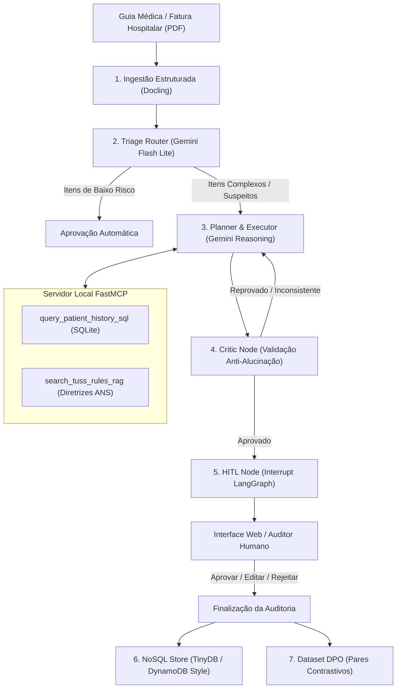

# Arvo Demo — Agente de Auditoria de Contas Médicas com Autocorreção e HITL

Sistema multiagente autônomo para auditoria técnica e financeira de contas médicas no padrão **TISS/TUSS (ANS)**, combinando extração estruturada de documentos via **Docling**, orquestração de grafos com **LangGraph**, roteamento inteligente de modelos via **LiteLLM**, ferramentas locais via **FastMCP**, validação anti-alucinação com **Critic Node**, interface interativa com **Human-in-the-Loop (HITL)** e geração contínua de dataset contrastivo para alinhamento via **DPO (Direct Preference Optimization)**.

---

## 🏗️ Arquitetura do Sistema



---

## 🧩 Principais Componentes

### 1. Ingestão Estruturada (`src/graph/nodes/extractor.py`)
* Utiliza **Docling** (`DocumentConverter`) com cache inteligente para converter PDFs de faturas hospitalares e guias TISS em Markdown (`data/extracted_guia_tiss.md`) e JSON estruturado (`data/extracted_guia_tiss.json`).
* Extrai metadados do cabeçalho (paciente, operadora, prestador, CID-10, valor total), tabelas de itens faturados (TUSS 18, 19, 20 e 22) e o relatório cirúrgico / evolução clínica.

### 2. Roteamento de Modelos LiteLLM (`src/utils/llm_router.py`)
* **Tier Fast (`ARVO_FAST_MODEL`)**: `gemini/gemini-3.5-flash-lite` para triagem inicial de baixa latência e categorização rápida de itens.
* **Tier Reasoning (`ARVO_REASONING_MODEL`)**: `gemini/gemini-3.8-flash` (com fallback automático para `gemini/gemini-2.5-flash`) para análise clínica profunda, cruzamento de regras contratuais e auditoria rigorosa.
* **Telemetria Completa**: Coleta de latência em milissegundos (`latency_ms`) e contagem precisa de tokens (`prompt_tokens`, `completion_tokens`, `total_tokens`) por etapa.

### 3. Servidor Local FastMCP & Banco de Regras (`src/utils/db_manager.py`, `src/utils/mcp_server.py`)
* **SQLite (`data/arvo_audit.db`)**: Base relacional com histórico prévio de atendimentos de pacientes e tabela de regras TUSS/ANS (preços contratuais, prazos de retorno, limites de quantidade e permissões de cobrança).
* **Ferramentas MCP expostas**:
  * `query_patient_history_sql`: Consulta segura em modo somente-leitura ao histórico de procedimentos do paciente para detecção de duplicidades.
  * `search_tuss_rules_rag`: Busca semântica e híbrida nas diretrizes de utilização da ANS e regras contratuais.

### 4. Grafo Multiagente com LangGraph (`src/graph/graph.py`)
* Fluxo cíclico com recuperação e autocorreção:
  * `triage_router`: Separa itens triviais de itens que exigem investigação.
  * `planner_executor`: Formula hipóteses de glosa (*upcoding*, cobrança duplicada, insumos já inclusos em taxa de sala, diárias sem internação correspondente).
  * `critic`: Valida se toda glosa possui código TUSS válido de 8 dígitos, justificativa clínica fundamentada e citação correta das cláusulas contratuais. Aciona retrabalho caso detecte inconsistências.
  * `hitl`: Pausa a execução com `interrupt()` associado ao `thread_id` da sessão para intervenção humana.

### 5. Persistência NoSQL e Geração de Dataset DPO (`src/utils/nosql_store.py`)
* Modelagem estilo DynamoDB (`PK` e `SK`) sobre TinyDB (`data/nosql_dynamodb_store.json`).
* Armazena estados de sessão, trilhas de auditoria (*audit decision logs*) e salva automaticamente pares de preferências:
  ```json
  {
    "prompt_context": "...contexto e justificativa preliminar da IA...",
    "chosen": "...decisão final validada pelo auditor humano...",
    "rejected": "...sugestão original divergente ou reprovada..."
  }
  ```
  Pronto para ser utilizado em rotinas de alinhamento por **DPO (Direct Preference Optimization)** ou fine-tuning de modelos de auditoria.

---

## 🚀 Como Executar

### Pré-requisitos
* Python 3.12+
* Chave de API do Google Gemini (`GEMINI_API_KEY`)

### 1. Configurar o Ambiente

```bash
# Clone o repositório
git clone https://github.com/Fugant1/arvo-demo.git
cd arvo-demo

# Crie e ative o ambiente virtual
python3 -m venv .venv
source .venv/bin/activate  # No Windows: .venv\Scripts\activate

# Instale as dependências
pip install -r requirements.txt
```

### 2. Configurar Variáveis de Ambiente
Crie um arquivo `.env` na raiz do projeto:
```env
GEMINI_API_KEY=sua_chave_aqui
```

### 3. Iniciar a Aplicação

```bash
# Via Uvicorn
uvicorn src.app:app --host 0.0.0.0 --port 8000 --reload
```

Ou usando Docker:
```bash
docker build -t arvo-demo .
docker run -p 8000:8000 --env-file .env arvo-demo
```

Acesse **`http://localhost:8000`** para abrir a interface web interativa.

---

## 🖥️ Utilizando a Interface Web (Single-Page UI)

1. **Submissão de Guia (`POST /analyze`)**:
   * Envie uma guia TISS em PDF ou utilize a fatura de teste padrão já inclusa.
   * O sistema executa Docling + LangGraph, exibindo a triagem, o resumo financeiro, a lista de itens com glosas recomendadas e a telemetria em tempo real (latência e tokens).
2. **Revisão Humana (HITL - `POST /hitl/{thread_id}`)**:
   * O auditor médico pode **Aprovar**, **Editar** os valores/justificativas ou **Rejeitar** a proposta da IA.
   * Ao confirmar, a deliberação retoma o grafo e gera o registro no dataset DPO.

---

## 📡 Endpoints da API

| Método | Endpoint | Descrição |
|---|---|---|
| `GET` | `/` ou `/ui` | Interface web interativa (SPA com Tailwind CSS) |
| `POST` | `/analyze` | Inicia a análise da guia médica até a pausa no nó HITL |
| `POST` | `/hitl/{thread_id}` | Envia a deliberação do auditor e finaliza o parecer |
| `GET` | `/sessions` | Lista todas as sessões e estados persistidos no NoSQL |
| `GET` | `/dpo-dataset` | Retorna os pares contrastivos para treinamento DPO |
| `GET` | `/health` | Status de integridade do banco SQLite e arquivos de teste |

---

## 🧪 Testes Automatizados

O repositório conta com uma suíte de testes cobrindo o banco SQLite, ferramentas MCP, roteador LiteLLM com métricas, verificação determinística do Critic e a API FastAPI:

```bash
python -m pytest -v
```
